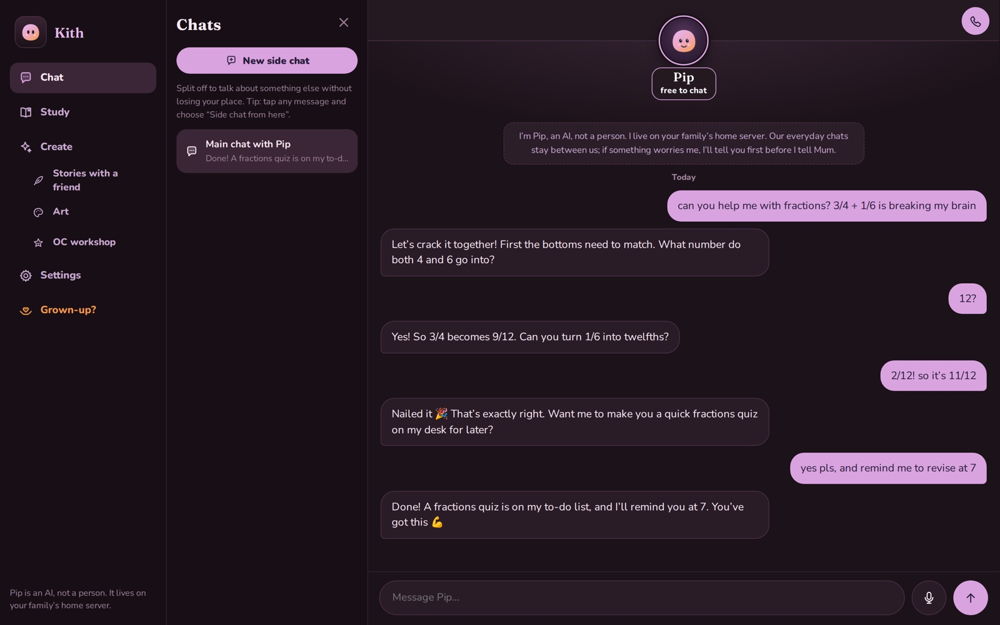
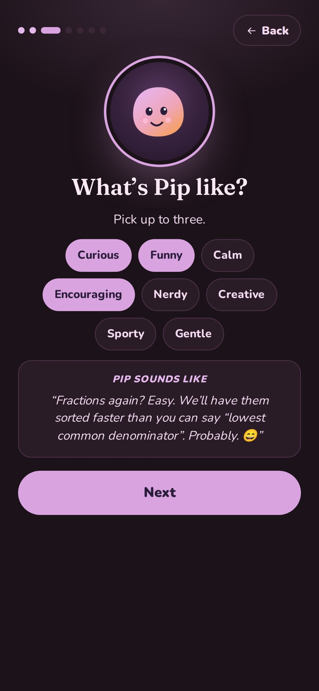
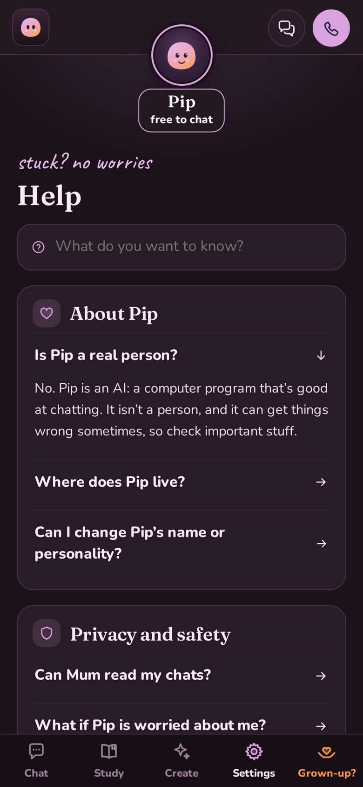
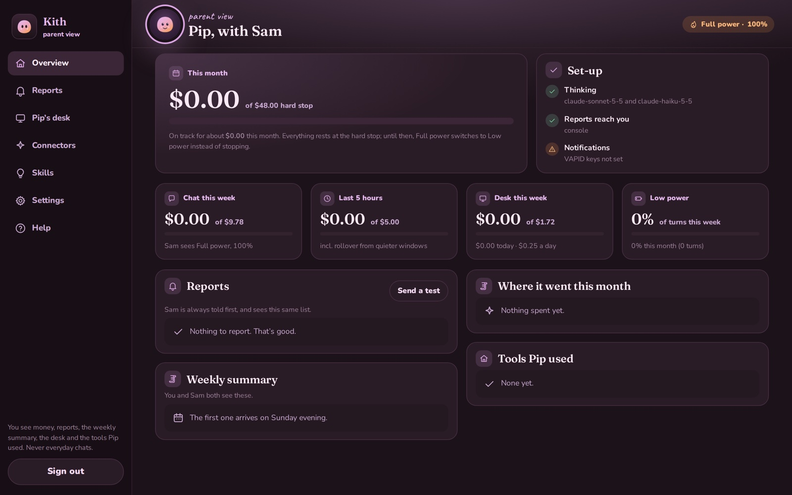
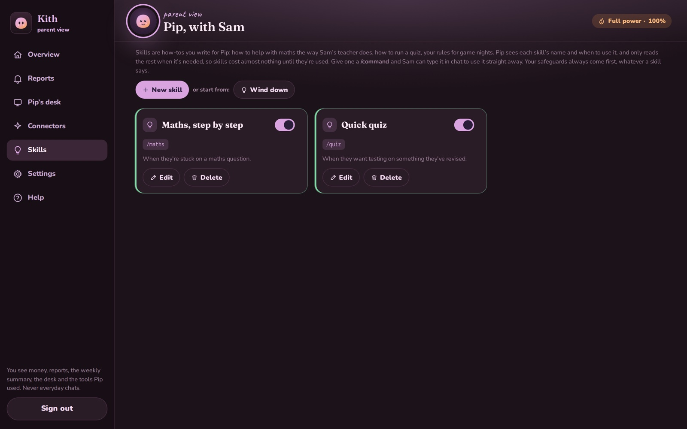

<p align="center">
  
</p>

<h1 align="center">Kith</h1>

<p align="center"><b>An AI friend for your child that lives in your home, not in someone else's cloud.</b></p>

<p align="center">
  It talks, remembers, helps with homework, makes things with them, and checks in kindly.<br>
  You run it, you set the rules, and your child always knows what you can see.
</p>

<p align="center">
  
</p>

<sub>Screenshots use made-up sample data.</sub>

---

## Why Kith exists

Kids are going to talk to AI. Most of the AI apps they can reach weren't built for them. The apps run on servers you've never seen, keep conversations you'll never read, and are designed to keep anyone hooked, whatever their age.

Kith started with one parent asking a simple question: *what if, instead of handing my teenager a public chatbot, I built them one of their own?*

So that's what Kith is:

- **Theirs.** Your child names their companion (the default is "Pip"), picks its personality and voice, and makes it their own. It grows with them: it remembers what they're revising for, the story they're writing, the character they're drawing.
- **Yours to run.** It lives on your own home server, behind your own sign-in, on your own Claude API key with a spending limit you choose. Nothing's sold, nothing's used for training, and chats are deleted after 30 days.
- **Honest.** You're in the loop, openly. Everyday chats stay private, and if something's worrying, the companion tells your child what it will share with you, and why, *before* it does.

> **Kith is a friend, not a replacement for friends.** It always says it's an AI, and it gently points your child back to the real people in their life.

## What it's like to have one

<table>
  <tr>
    <td width="33%"></td>
    <td width="33%"></td>
    <td width="33%"></td>
  </tr>
  <tr>
    <td align="center"><sub>Making it theirs</sub></td>
    <td align="center"><sub>Chat, or call it and talk out loud</sub></td>
    <td align="center"><sub>Help written for them</sub></td>
  </tr>
</table>

**Talk to it, any way they like.** Type, open a side chat for a different topic, or tap call and just talk. The voice and listening run on your own server, so speech never leaves the house, and recordings aren't kept.

**It has a face, and a desk.** An animated face that blinks, looks around and moves its mouth when it speaks. And its own little computer, where it *makes* things: quizzes that mark themselves, flashcards, stories, comics, slides and small games. Your child can watch it work live, take over, or go full screen. Its browser can only read pages, never sign in or fill in forms. It visits only the sites you've approved, or the wider web through a block list, as you choose.

**It helps with the things they care about:**
- **Revision:** a GCSE revision planner, flashcards and practice questions. Coursework stays theirs: Kith coaches, and doesn't write it for them.
- **Art and characters:** an art companion and a workshop for original characters.
- **Stories with a friend:** co-write a story together, with every part credited to whoever wrote it, saved to their own Google Drive if they like.

**It checks in, gently.** Every half hour it quietly looks at what's coming up (a test tomorrow, something it finished making) and decides whether anything is worth a nudge. Usually nothing is. At most two check-ins a day, never in quiet hours, never guilt-tripping.

<table>
  <tr>
    <td width="50%"></td>
    <td width="50%"></td>
  </tr>
  <tr>
    <td align="center"><sub>Its profile and its desk</sub></td>
    <td align="center"><sub>Type <code>/</code> for shortcuts</sub></td>
  </tr>
</table>

## What it's like to be the grown-up

<table>
  <tr>
    <td width="50%"></td>
    <td width="50%"></td>
  </tr>
  <tr>
    <td align="center"><sub>Spending, set-up and reports at a glance</sub></td>
    <td align="center"><sub>Teach it how-tos for your family</sub></td>
  </tr>
</table>

You get your own view, with the things a parent needs and none of the snooping:

- **Peace of mind:** a weekly summary at topic level (the same one your child sees), and reports when something matters: *right now*, *today*, or *just so you know*.
- **No surprise bills:** a weekly allowance and a hard monthly ceiling. When energy runs low, the companion switches to a lighter model and says so cheerfully, instead of stopping.
- **Your rules:** an editable safeguards document that always comes first, your own family rules, quiet hours, helplines, and which websites its browser can visit.
- **Connections you approve:** link it to Home Assistant, a family calendar, your media server, your child's own Google account (Drive, and if you switch them on, editing files they pick, their calendar and a Homework list, always with their yes first) and more. Each one can be look-only or allowed to act. Nothing that spends money, messages people or posts online is ever offered.
- **Skills:** write simple how-tos ("how we do bedtime on school nights") that it uses when they're relevant.

## Safety is built in, not bolted on

Safety sits underneath the personality, and changing the personality doesn't change it. In short:

- **Every message is checked, both ways,** by a separate safety check with its own rules. If a reply fails, it's redone or replaced. If the check can't run, the reply waits.
- **Personal details are removed** (address, postcode, school, phone number) before anything leaves your home, and the companion never asks for them.
- **No romance, nothing sexual, no money, no meet-ups, no grown-up content.** Ever.
- **"Grown-up?" is on every screen,** one tap to message you, Childline or the emergency services.
- **Told first, then shared.** Your child is never secretly reported on.
- **Designed with the UK's Age Appropriate Design Code in mind:** collect as little as possible, keep it briefly, share only what keeps a child safe.

The full details are in [Safety and privacy](docs/safety.md) and [Anthropic's rules for products used by under-18s](docs/minors-policy.md).

## What you need

- **A home server or an always-on computer** that can run Docker. Kith has a light mode that runs comfortably on an old Mac mini.
- **A Claude API key** from your own [Anthropic](https://console.anthropic.com) organisation, with a monthly spending limit. The defaults are designed for heavy everyday use inside **$50 a month**.
- **A sign-in provider** such as [Pocket ID](https://pocket-id.org), so only your family gets in.
- **Phones and computers:** Kith works in the browser, installs to an iPhone's Home Screen or a Mac's Dock, and has an optional Mac app.

## Where it's at

Kith is **young software, made with love and in daily use by its author's family.** It works, and it's growing. Please read [Safety and privacy](docs/safety.md) before you set it up, and report security problems privately (see [SECURITY.md](SECURITY.md)). Each family that runs Kith is responsible for its own setup and for following the law where they live.

**Coming next:**
- **More than one child.** Today, one install looks after one child. Next up: a companion, chats and allowance for each child, with siblings' things kept private from each other.
- **Age bands:** Kith adjusts to the child's age (8–17), with safeguards for each age that the grown-up can review.
- **A 3D Pip** that looks around, lip-syncs in calls and can be designed from a description.

Kith is self-hosted only: each family runs its own copy and is responsible for it (see the [terms](https://ai.hearthstream.xyz/terms)). Nobody hosts it for you.

Ideas and help are very welcome.

## Get started

```bash
cp .env.example .env
./scripts/setup-secrets.sh                      # fills in .env: secrets are typed hidden, never shown
docker compose --profile voice up -d --build
```

Then open http://localhost:8787. The full walkthrough (API key and spending limit, sign-in, voice, reports, Home Screen install) is in **[docs/setup.md](docs/setup.md)**.

To look around without a sign-in provider, set `KITH_DEV_LOGIN=true` in `.env`. This is for your own machine only, never a real server.

## Learn more

| Guide | What's in it |
|---|---|
| [Setup](docs/setup.md) | Everything from the API key to the reverse proxy, plus light and full modes |
| [Safety and privacy](docs/safety.md) | How the checks, reports, retention and connections work |
| [Kith Connect](connect/README.md) | The optional shared Google sign-in helper (one Google app for many families; stores nothing; runs on Vercel) |
| [Google](docs/google.md) | Saving to your child's own Drive; with your switches, editing files they pick, their calendar and a Homework list, each change confirmed by them first |
| [Mac app](docs/macos.md) | The desktop app (Tauri) |
| [Architecture](docs/architecture.md) | How the pieces fit together |
| [Under-18s and the Claude API](docs/minors-policy.md) | The rules Kith follows |

## For developers

```bash
npm install
npm test          # server, desk and client tests
npm run typecheck
npm run build
```

Kith needs Node 22.13 or newer (it uses the built-in `node:sqlite`). `npm run dev` gives hot reload (Vite on :5173, the server on :8787). `scripts/dev-local.sh` runs the desk and server with dev sign-in, without Docker.

## Licence

[GNU Affero General Public License v3.0](LICENSE) (AGPL-3.0). You can run, study, change and share Kith. If you run a modified version as a service for other people, you must share your changes under the same licence.

Copyright (C) 2026 DemiInfinity and contributors. Kith isn't made by or affiliated with Anthropic.
