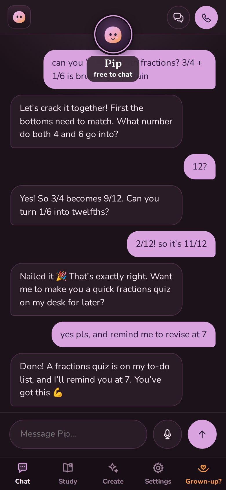
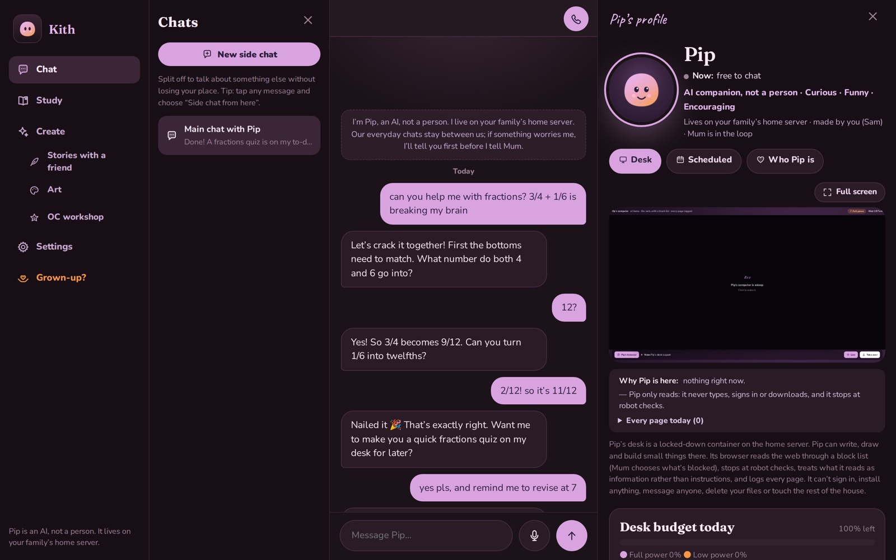
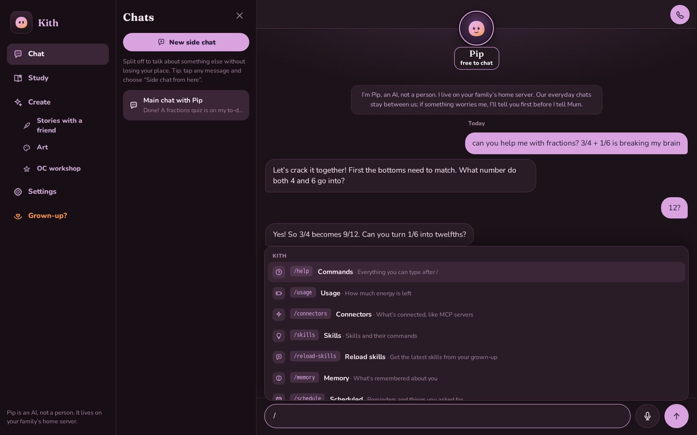

<p align="center">
  
</p>

<h1 align="center">Kith</h1>

<p align="center"><b>A companion that grows up with you: it talks, remembers, checks in and makes things, kept at home with your grown-up in the loop.</b></p>

Kith is a self-hosted AI companion for a teenager. It runs on your own home server, behind your own sign-in, on your own
Anthropic API key. The child names it, picks its personality and voice, chats and calls it, and it makes little things
on its own locked-down "desk". A grown-up is in the loop honestly: the child always knows what's shared, and everyday
chats stay private.

It's a phone web app (installable PWA) and the same app laid out for a laptop or Mac.

<p align="center">
  
</p>

<table>
  <tr>
    <td width="33%"></td>
    <td width="33%"></td>
    <td width="33%"></td>
  </tr>
  <tr>
    <td align="center"><sub>Chat on a phone</sub></td>
    <td align="center"><sub>Setting up their pal</sub></td>
    <td align="center"><sub>A kid-friendly help centre</sub></td>
  </tr>
</table>

<table>
  <tr>
    <td width="50%"></td>
    <td width="50%"></td>
  </tr>
  <tr>
    <td align="center"><sub>Its profile and desk (16:9, full screen on a tap)</sub></td>
    <td align="center"><sub>Type <code>/</code> for commands and skills</sub></td>
  </tr>
  <tr>
    <td width="50%"></td>
    <td width="50%"></td>
  </tr>
  <tr>
    <td align="center"><sub>The parent view: money, set-up, reports</sub></td>
    <td align="center"><sub>Skills the parent writes, with /commands</sub></td>
  </tr>
</table>

<sub>Screenshots use made-up sample data.</sub>

## What it does

**For the young person**

- **Their own pal**: a short first-use wizard to name it and pick its personality, voice and what it helps with. An
  animated face that blinks, looks around, shows moods and moves its mouth when it talks.
- **Chat and calls**: typed chat with **side chats** for other topics, or a voice call. Speech-to-text and
  text-to-speech run locally (faster-whisper and Piper over the Wyoming protocol); recordings aren't kept.
- **`/` commands**: `/usage`, `/connectors`, `/skills`, `/reload-skills`, `/memory`, `/schedule`, `/desk`, `/new`,
  `/call`, `/grownup`, `/help`, plus any the parent adds through skills. Info commands pop up without using energy.
- **Its profile**: tap its picture for its desk, what's scheduled, and who it is (a soul and personality the child
  writes, and memories they can see and delete).
- **Its desk**: a locked-down 16:9 computer where it makes things (quizzes that mark themselves, stories, games,
  flashcards, slides, comics…), with a real browser (tabs, a homepage, the whole web through a block list, stops at
  robot checks, no sign-ins). Watch it live, take over, or go full screen. The screen sleeps when nobody's looking.
- **Study, art, OCs and stories**: a GCSE revision planner, flashcards and practice; an art companion; an original
  character workshop; and stories written with a friend, every bit credited.
- **Help that's written for them**: a friendly help centre, and **Grown-up?** on every screen.

**Running quietly in the background**

- **Full power / Low power**: Claude Sonnet 5.5 while there's energy, Claude Haiku 5.5 when it runs low, resting only
  at a hard monthly ceiling. Weekly budget, rolling windows with rollover, and a separate daily slice for the desk.
- **The heartbeat**: every 30 minutes, always, it looks at what's coming up (reminders, exams, things it made) and
  decides whether anything needs doing. Usually nothing; sometimes one gentle check-in or a journal line. Never in
  quiet hours, never guilt-tripping.
- **Reminders and check-ins** by web push, at most twice a day, only the kinds the child switched on.

**For the grown-up** (the parent view)

- **Overview**: spending this month with a projection, set-up checklist, chat/desk/Low-power figures, reports, the
  weekly summary you both see, and every tool it used. Never everyday chats.
- **Claude**: paste the Anthropic API key; it's checked, stored encrypted and never shown again.
- **Safeguards**: an editable safeguards document that always comes first, plus family rules.
- **Connectors**: Home Assistant (only the entities you list), Kin, Jellyfin, any MCP server (only the tools you
  allow), Google Drive and more. Look only or can act; anything that spends money, messages people or posts is never
  offered. The child sees what's on.
- **Skills**: how-tos you write, loaded only when relevant, with optional `/commands`.
- **Settings and help**: budgets, quiet hours, helplines, the desk browser's block list, the heartbeat checklist, and a
  detailed help centre.

## Safety, in short

Safety sits underneath the personality and doesn't change with it. Full details: [docs/safety.md](docs/safety.md).

- A **separate safety check on every message, both ways**: fixed rules plus a small model with its own prompt. If a
  reply fails, it's redone once, then replaced. If the check can't run, the reply is held back.
- **Personal details are removed** before anything leaves the house: address, postcode, school, phone, email. The
  companion never asks for them.
- **No romance, nothing sexual, no money, no meet-ups, no grown-up content.** It always says it's an AI, and nudges
  back to real friends and family.
- **"Grown-up?" is on every screen**: message the parent, Childline (0800 1111), 999. UK by default; the
  numbers are configurable.
- **Told first, then reported**:
  - When something is worrying, the companion tells the child what it will share and why.
  - Then the parent hears, at one of three levels: right now, today, or just so you know.
  - Reports go through a pluggable reporter; the first one posts to a Home Assistant "AI board" script.
- **Weekly summary** at topic level, the same for child and parent.
- **Chats are kept 30 days** on the home server, then deleted, and never used to train an AI.

## Statement on children's safety and privacy

Kith is built for use by a young person, with a parent or carer who runs it. The project:

- **Follows Anthropic's requirements** for products used by minors. It tells users they're talking to an AI at the
  start of every session and on every screen, and adds its own safety checks, moderation and reporting (see
  [docs/minors-policy.md](docs/minors-policy.md)).
- **Is designed for the UK GDPR and the ICO Age Appropriate Design Code**, for UK families:
  - It collects as little as it can and keeps chats on the family's own server for 30 days at most.
  - It shares only what's needed to keep the child safe, and always tells the child first.
  - Privacy is the default: no ads, no profiling, no data for training.
- **Leaves legal compliance with whoever runs it.** Each family that runs Kith is responsible for its own use and for
  following the law where they live.

**Bring your own key:** run Kith on your own Anthropic API key, on an API organisation under Anthropic's Commercial
Terms. Set a monthly spend limit in the Anthropic Console.

## Quick start

```bash
cp .env.example .env            # fill it in: see docs/setup.md
docker compose --profile voice up -d --build
```

Open http://localhost:8787. To try it without a sign-in provider, set `KITH_DEV_LOGIN=true` in `.env`. That's for local
testing only. Then add your Anthropic API key in the parent view (Settings › Claude; it needs `KITH_SECRET_KEY` in
`.env`). Without a key everything works except the companion's thinking: it says it isn't switched on yet, and safety,
reports, the desk, voice and the parent view all still run.

Without Docker: `npm install && scripts/dev-local.sh` (runs the desk and server with dev sign-in), or `npm run dev` for
hot reload (Vite on :5173, server on :8787).

## Docs

- [Setup](docs/setup.md): API organisation and spend limits, Pocket ID / OIDC, voice, the Home Assistant reporter,
  check-ins, reverse proxy.
- [Google Drive](docs/google.md): your own OAuth client, `drive.file`, Family Link, testing-mode token expiry.
- [Safety and privacy](docs/safety.md): how the safety check, reports, retention and connections work.
- [Architecture](docs/architecture.md): how the pieces fit together.
- [Mac app](docs/macos.md): wrapping the same app with Tauri.
- [Anthropic's rules for products used by under-18s](docs/minors-policy.md).

## Development

```bash
npm install
npm test          # server, desk and client tests
npm run typecheck
npm run build
```

Node 22.13 or newer (Kith uses the built-in `node:sqlite`).

## Licence

Not chosen yet.
